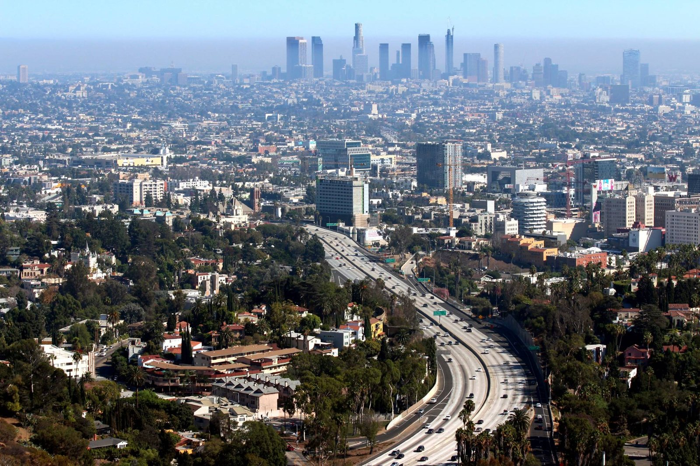
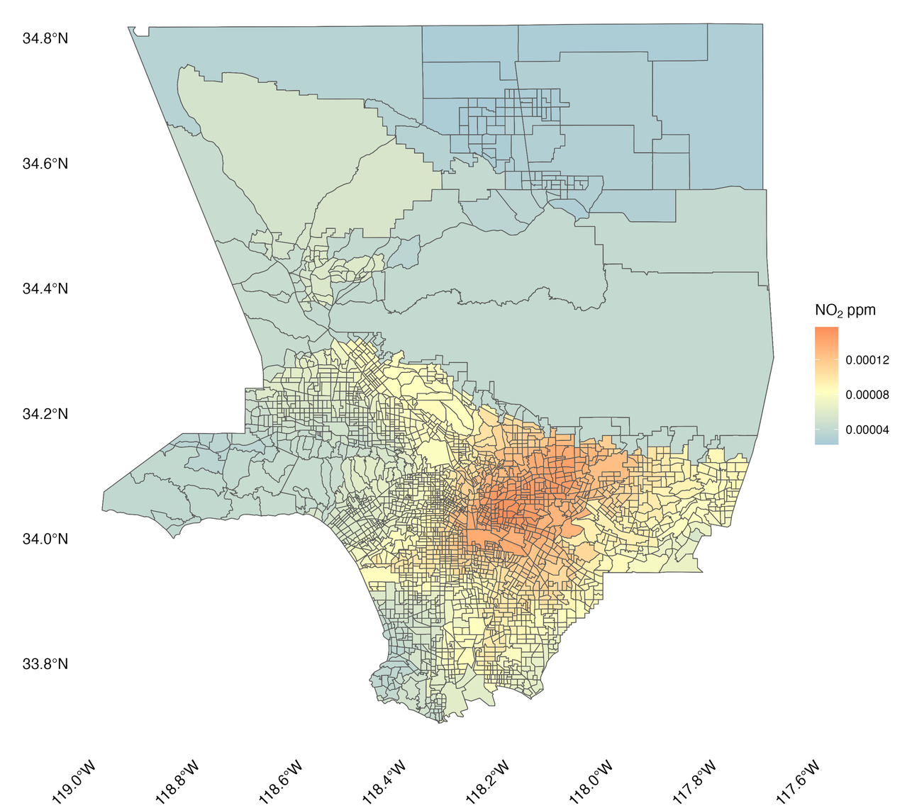
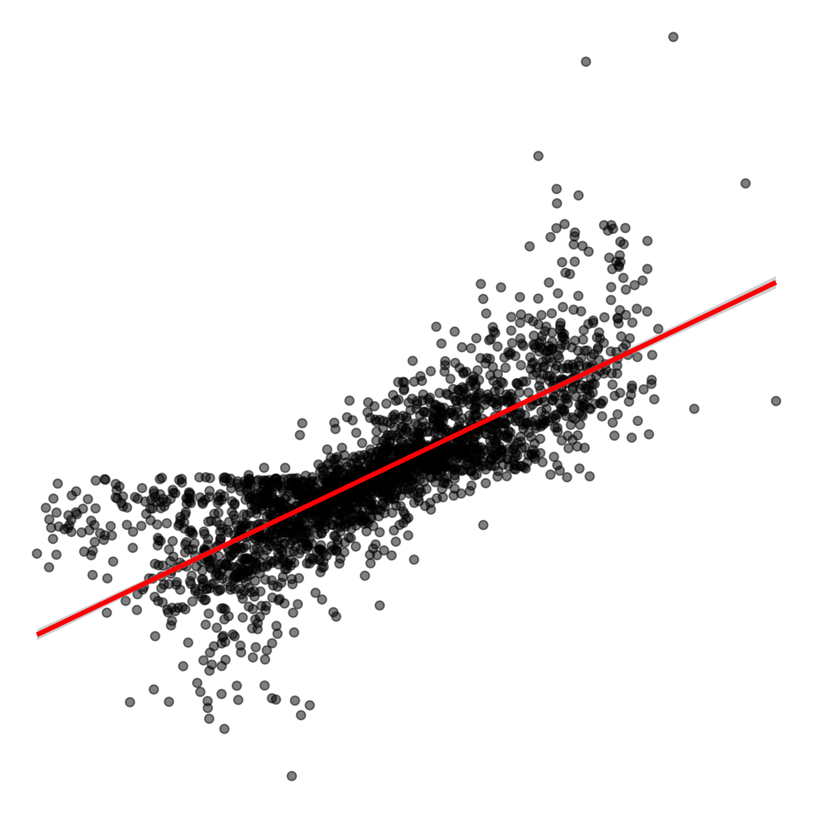

# Air (In)equality in Los Angeles

**Do neighborhoods with different demographics and incomes breathe different air?** This project combines satellite pollution data with U.S. Census data for 2,334 census tracts in Los Angeles County and tests the link with spatial regression.



*Downtown Los Angeles under its smog layer. Photo: ["Hollywood Freeway 101"](https://commons.wikimedia.org/wiki/File:Hollywood_Freeway_101_%2829751413541%29.jpg) by Prayitno, [CC BY 2.0](https://creativecommons.org/licenses/by/2.0/), via Wikimedia Commons. Resized from the original.*



*Average tropospheric NO₂ column density (mol/m²) per census tract, July 2023 (Sentinel-5P). Pollution concentrates in the central and eastern part of the county.*

## What this project shows

| Step | File |
|---|---|
| Pulling census data and boundaries through an API | `code/01-get-census-data.R` (`tidycensus`, `tigris`) |
| Requesting and processing satellite rasters | `code/02-get-no2-data.py` (Sentinel Hub API, custom evalscript) |
| Joining raster and vector data (zonal statistics, CRS alignment) | `code/03-combine-spatial-data.R` (`terra`, `sf`) |
| Spatial weights, Moran's *I*, SLX and spatial error models | `code/04-spatial-regression.R` (`spdep`, `spatialreg`) |
| Cartography and figures | `code/05-plots.R`, `figures/` |
| Reproducible write-up in R and Python | `docs/report.qmd` (Quarto) |

## Data

- **NO₂:** Sentinel-5P TROPOMI tropospheric NO₂ column density (mol/m²), averaged over July 2023, requested through the Copernicus Data Space Ecosystem at 0.005° resolution.
- **Demographics and income:** U.S. Census Bureau 2018-2022 American Community Survey, tract level. Variables are population by race and ethnicity, poverty, median household income, income per capita, median home value and share of college graduates. Catalina and San Clemente islands are dropped, and tracts with missing values are removed, leaving 2,334.

## Method

1. Average the NO₂ raster within each census tract.
2. Drop variables with pairwise correlation above 0.65, which leaves median home value, poverty rate, population density and the shares of white, Black, Asian and Hispanic residents.
3. Fit a linear baseline model.
4. Build inverse distance spatial weights from the 100 nearest tract centroids and test the residuals with Moran's *I*.
5. Fit a spatially lagged X (SLX) model and a spatial error model, and compare them by AIC.

## Results

### Original model

The residuals of the linear model are strongly spatially autocorrelated (Moran's *I* = 0.72), so a spatial model is needed. The SLX model does not help (0.73). The spatial error model has the lowest AIC of the models in `code/04-spatial-regression.R`.

| Variable | Estimate | p-value |
|---|---|---|
| Median home value | +1.26e-11 | < 0.001 |
| Population density | +6.77e-10 | < 0.001 |
| Share Asian | +6.99e-05 | < 0.001 |
| Share Hispanic | +5.99e-05 | < 0.001 |
| Share Black | +2.10e-05 | 0.004 |
| Poverty rate | -1.30e-05 | 0.024 |
| Share white | -5.61e-06 | 0.324 (not significant) |

Spatial error model: Nagelkerke pseudo-R² 0.651, AIC -44,517, λ = 0.029 (p < 0.001), residual Moran's *I* 0.47.



### Sensitivity checks (`code/04b-spatial-model-checks.R`)

The residual autocorrelation of 0.47 turned out to come mostly from how the model was set up. The checks also show that the headline associations do not hold up.

**1. The weights and the diagnostic.** The original weights were binary-style (unnormalized) with 100 neighbors, which also makes the spatial lag model fail with a singular matrix. With row-standardized weights and Moran's *I* computed on the filtered residuals (the right test for an error model), the leftover autocorrelation is close to zero for k = 8 neighbors.

| Weights (no distance term) | Moran's *I*, linear model | Moran's *I*, spatial error model (filtered) | λ |
|---|---|---|---|
| 100 neighbors, IDW, row-standardized | 0.83 | 0.09 | 1.00 |
| 15 neighbors, IDW, row-standardized | 0.89 | 0.05 | 0.995 |
| 8 neighbors, row-standardized | 0.89 | -0.005 | 0.994 |
| Queen contiguity, row-standardized | 0.89 | -0.29 | 0.997 |

**2. The error term absorbs nearly everything.** λ is about 0.99 under every weights choice, so the model treats the NO₂ surface as almost entirely spatial. Nagelkerke R² of 0.99 reflects that, not explanatory power. Queen contiguity overcorrects (filtered Moran's *I* of -0.29).

**3. Location matters most.** Adding distance to downtown Los Angeles cuts the linear model's AIC from 10,633 to 9,048 and the spatial error model's (8 neighbors) from 875 to 443. Spatial Durbin error has the lowest AIC (338). Lagrange multiplier tests favor an error model over a lag model (adjusted LM statistics of 965 for error and 464 for lag).

**4. The demographic associations mostly disappear.** Coefficients below use 8-neighbor row-standardized weights, standardized predictors, and NO₂ in units of 1e-5 mol/m².

| Variable | Linear | Spatial error | Spatial error + distance |
|---|---|---|---|
| Median home value | +0.60 *** | -0.03 * | -0.03 *** |
| Population density | +0.14 * | +0.02 | +0.01 |
| Share Asian | +1.25 *** | +0.02 | +0.02 |
| Share Hispanic | +2.00 *** | +0.04 | +0.04 (p = 0.08) |
| Share Black | +0.17 | 0.00 | 0.00 |
| Poverty rate | +0.02 | +0.01 | +0.01 |
| Distance to downtown (km, z-score) | | | -1.52 *** |

Stars mark p < 0.05 (*) and p < 0.001 (***). In a plain linear model with the distance term, shares of Asian and Hispanic residents stay positive and significant, while home value and density turn negative.

**What this means.** In a model with no spatial error structure, tracts with more Asian and Hispanic residents have higher NO₂. Once the spatial error is estimated properly, that link is no longer distinguishable from the smooth geographic gradient around downtown. The original significant results came from the unnormalized weights, so treat them as exploratory. The data supports a narrower claim: NO₂ in July 2023 is organized mostly by location, and tract-level demographics add little once location is accounted for. Demographics are themselves clustered in space, so this does not show that demographics are unrelated to exposure.

## Limitations

- **The spatial error model is close to a boundary.** λ is about 0.99 in every specification, so coefficient estimates depend heavily on the weights choice. I did not try geographically weighted regression, distance to freeways or the coast, or a finer NO₂ source.
- **One month, one pollutant.** July 2023 NO₂ is not an annual exposure measure. Seasonal wind and temperature shift where NO₂ sits.
- **Satellite column, not ground exposure.** Sentinel-5P measures NO₂ through the whole atmosphere above each pixel. Values are tropospheric column densities in mol/m², not ground-level concentrations. Tract values range from 2.3e-05 to 1.6e-04 mol/m² (median 8.3e-05, about 5e15 molecules/cm²), which is a normal range for the Los Angeles basin. Read as ppm, the same median would be 0.08 ppb, roughly a hundred times below typical surface NO₂ in the city. The sensor's native footprint is several kilometers, so the 0.005° grid is resampled and fine tract-to-tract differences are smoothed.
- **Aggregation.** Tract averages say nothing about individuals (ecological fallacy), and large rural tracts in the north average over mostly empty land.
- **Association, not cause.** The model contains no traffic, industry or land-use data, and the analysis covers Los Angeles County only.

## Reproduce it

The processed data is in `data/`, so steps 3 to 5 run without any credentials.

```bash
Rscript code/00-install-packages.R
pip install -r requirements.txt
```

Run the scripts in order from the repository root:

1. `code/01-get-census-data.R` needs a [Census API key](https://api.census.gov/data/key_signup.html), set as `CENSUS_API_KEY` or saved to `api-keys/census-api-key.txt`.
2. `code/02-get-no2-data.py` needs a [Copernicus Data Space](https://shapps.dataspace.copernicus.eu/dashboard/#/) OAuth client, set as `SH_CLIENT_ID` and `SH_CLIENT_SECRET`. The monthly download is already stored as `data/copernicus/response.tiff`.
3. `code/03-combine-spatial-data.R`
4. `code/04-spatial-regression.R` is the original analysis. Its spatial lag model fails because of the unnormalized weights.
   `code/04b-spatial-model-checks.R` runs the sensitivity checks and takes about 10 minutes.
5. `code/05-plots.R`

To render the full narrative with code, run `quarto render docs/report.qmd`. The coefficient tables are in `code/06-tables.qmd`.

## Repository layout

```
code/      numbered analysis scripts
data/      census tracts, Sentinel-5P rasters, merged analysis table
figures/   maps and diagnostic plots
docs/      Quarto report and bibliography
```

## Sources

- European Space Agency. Sentinel-5P. [Copernicus Data Space documentation](https://documentation.dataspace.copernicus.eu/notebook-samples/sentinelhub/air_pollution_statistics.html)
- Walker, K., Herman, M., & Eberwein, K. (2024). *tidycensus*. [CRAN](https://cran.r-project.org/web/packages/tidycensus/index.html)
- Aeroqual. [Why measure nitrogen dioxide NO₂?](https://www.aeroqual.com/measurements/gases/nitrogen-dioxide)

---

*This analysis began as a final project for Geospatial Analysis taught by Alexandra Kapp at the Hertie School (spring 2024). Code is MIT licensed. Census and Copernicus data are public and subject to their providers' terms.*
